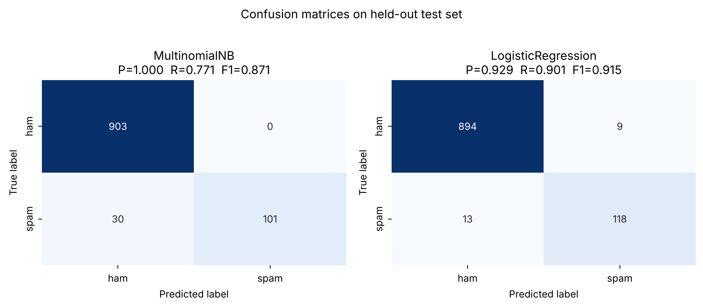

# Task 2 — Spam Message Classifier (NLP)

CodeNova AI/ML Internship · Batch 01

Classifies SMS messages as spam/ham using TF-IDF features and compares **Multinomial Naive Bayes** with **Logistic Regression**.
Dataset: [SMS Spam Collection](https://archive.ics.uci.edu/dataset/228/sms+spam+collection) (5,574 rows → 5,169 after removing exact duplicates; 12.6% spam).

## Tech stack
Python · scikit-learn · pandas · matplotlib/seaborn · joblib (no paid services)

## Pipeline
1. Preprocess: lowercase → regex tokenisation → stop-word removal (digits kept — phone numbers/prices signal spam)
2. TF-IDF (1–2-grams, `min_df=2`, sublinear TF) **inside** a scikit-learn `Pipeline`, so it is fit on training folds only
3. Stratified 80/20 split made **before** anything is fit; hyperparameters chosen with 5-fold CV on the training set only, scoring **precision**
4. One-time evaluation on the 1,034 held-out messages

## Results (held-out test set)
| Model | Precision | Recall | F1 | False positives (ham→spam) | Missed spam |
|---|---|---|---|---|---|
| **Multinomial NB** (α=1.0) — *selected* | **1.000** | 0.771 | 0.871 | **0** | 30 |
| Logistic Regression (C=30, balanced) | 0.929 | 0.901 | 0.915 | 9 | 13 |

Selection followed the task's priority: avoid marking legitimate messages as spam. NB had the best CV precision and produced **zero** false positives on the test set. The trade-off is lower recall (30 of 131 spam messages missed); if catching more spam matters more, Logistic Regression has the better F1. With only 131 spam messages in the test set, a precision of 1.000 carries uncertainty — treat it as "very high", not "perfect".



## Files
`spam_classifier.py` (train/evaluate) · `text_utils.py` (preprocessing) · `predict.py` (interactive/one-shot inference) · `spam_pipeline.joblib` (saved vectoriser+model) · `metrics.json` · `train_log.txt` · `sample_predictions.log`

## Usage
```bash
pip install -r ../requirements.txt
python spam_classifier.py                 # retrain + evaluate
python predict.py                         # interactive prompt
python predict.py "Free entry! Call now to claim your prize"
```

## Sample predictions (`sample_predictions.log`)
```
[SPAM] p(spam)=0.981 | WINNER!! You have won a £1000 cash prize. Call 09061701461 now to claim
[SPAM] p(spam)=0.681 | Free entry to win tickets, text WIN to 80082 now
[SPAM] p(spam)=0.979 | URGENT! Your mobile number has been awarded 2000 bonus caller prize, call now
[HAM ] p(spam)=0.003 | Hey, are we still meeting for lunch at 1pm tomorrow?
[HAM ] p(spam)=0.025 | Can you send me the notes from today's class? Thanks!
[HAM ] p(spam)=0.006 | Ok I'll be home by 7, don't forget to buy milk
[SPAM] p(spam)=0.742 | Congratulations! You've been selected for a free iPhone, click the link to claim
[HAM ] p(spam)=0.009 | Happy birthday! Hope you have an amazing day with family
```

## Limitations
Trained on 2000s-era UK/Singapore SMS; modern phishing, other languages and non-SMS text may behave differently. Bag-of-words ignores word order and context.
